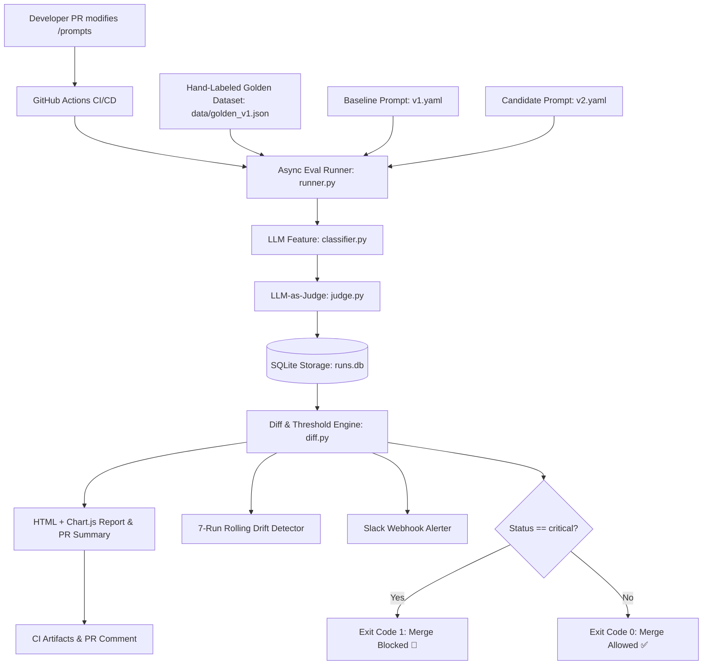

# Model Regression Detection System (CI/CD for LLMs)
## Master Plan & Architecture Specification

### 1. Vision & Purpose
Every AI team ships prompt changes blind. This system creates an automated CI/CD pipeline that continuously evaluates LLM-powered features against a golden dataset whenever a prompt, model, or configuration changes. It detects quality regressions, calculates statistical delta drops, tracks long-term drift, sends rich Slack alerts, and **blocks pull request merges on critical regressions**.

---

### 2. Architecture & Data Flow

---

### 3. Phases & Milestones

#### Phase 1: Feature Under Test (`src/models.py`, `src/prompts.py`, `src/classifier.py`)
- Pydantic models for structured input/output (`Category`, `ClassificationResult`, `PromptConfig`).
- YAML prompt versioning (`prompts/v1.yaml`, `prompts/v2.yaml`, `prompts/v3_regression.yaml`).
- Deterministic extraction with temperature=0.

#### Phase 2: Golden Dataset (`data/golden_v1.json`)
- 50+ hand-curated realistic customer support emails across all four categories (`billing`, `technical`, `account`, `general`).
- Deliberate edge cases: sarcasm, mixed language, typos, extremely short messages, multi-intent ambiguity.
- Difficulty labeling (`easy`, `medium`, `hard`) and test rationale notes.

#### Phase 3: Evaluation Engine (`src/judge.py`, `src/runner.py`, `src/store.py`, `src/diff.py`)
- **LLM-as-a-Judge**: 1-5 scoring for summary accuracy and relevance, penalizing hallucinations.
- **Async Test Runner**: Async batching with concurrency control (`asyncio.Semaphore(8)`), latency measurement, and token tracking.
- **SQLite Persistence**: Stores runs, individual case predictions, and judge feedback.
- **Diff & Threshold Engine**: Delta pass rate, per-category delta, flipped case categorization (regressions vs. improvements), warning/critical thresholding.

#### Phase 4: Alerting & Reporting Layer (`src/report.py`, `src/slack.py`)
- **Interactive HTML Report**: Summary scorecards, interactive trend charts (Chart.js), side-by-side comparison tables of regressed cases.
- **PR Markdown Summary**: Concise markdown payload for GitHub PR comments.
- **Slack Alerts**: Rich Block Kit alerts with status emojis (✅, ⚠️, 🚨) and headline summaries.
- **Slow Drift Detection**: Rolling window average evaluation (e.g. 7-run window) catching gradual model/prompt decay.

#### Phase 5: CI/CD & Production Readiness (`.github/workflows/eval.yml`, `Dockerfile`, `src/cli.py`)
- **CLI Entrypoint**: `python -m src.cli --candidate v2 --baseline v1`.
- **Exit Code Gating**: Exits with code 1 on critical regressions.
- **GitHub Actions**: Triggers on PR changes in `prompts/**`, comments report on PR, blocks merge.
- **Containerization**: Self-contained Dockerfile ready for any CI runner or Kubernetes cron job.

#### Phase 6: Portfolio Polish & Demo Strategy
- Reproducible regression demo (`v3_regression.yaml`).
- Clear architectural trade-off documentation.
